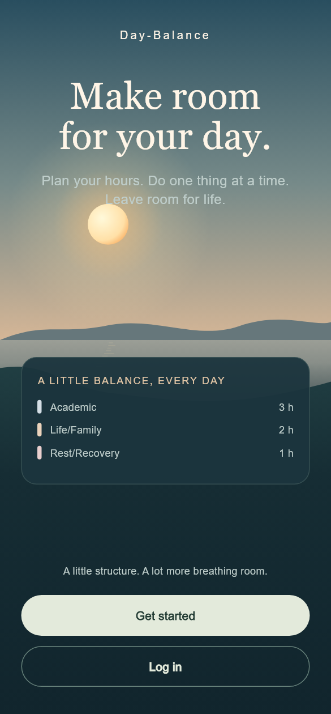
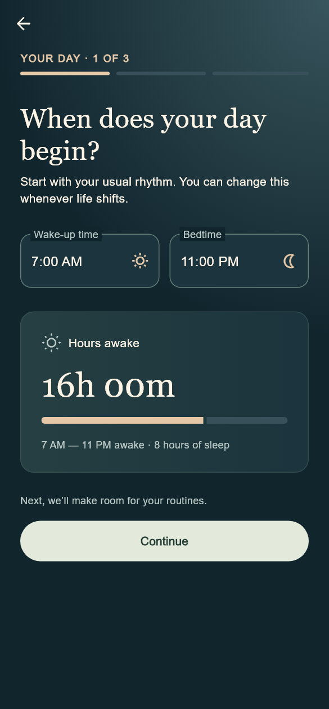
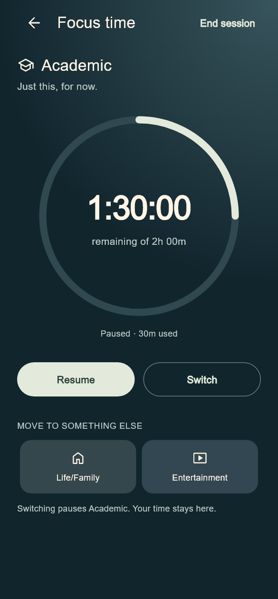

<div align="center">
  

  <h1>Day-Balance</h1>
  <p><strong>Give your day a time budget.</strong></p>
  <p>Plan the hours you have, focus on one thing at a time, and see where your day went.</p>
  <p><a href="#screens">Screens</a> · <a href="#tech-stack">Tech stack</a> · <a href="#run-locally">Run locally</a> · <a href="#project-structure">Project structure</a></p>
</div>

## How it works

1. **Set your rhythm.** Enter your wake-up time, bedtime, and daily routines. Day-Balance calculates the time left to plan.
2. **Make a plan.** Assign time to categories such as Academic, Career, or Rest. You can also create private categories with a name, color, and optional description.
3. **Start a timer.** Focus on one category, pause or switch when plans change, and see when you go over your time budget.
4. **Review your day.** Compare planned and actual time in the daily summary.

For example, if you're awake for **16 hours** and your routines take **2 hours**, you have **14 hours** to plan.

## Screens

These previews are from the project's Figma exports. The Flutter app uses the newer evening theme, so its colors and some details differ.

| Set your schedule | Plan your day | Start a timer |
| :---: | :---: | :---: |
|  |  |  |

The app's onboarding includes a sun and moon animation while your settings are saved. See the [design index](design/FIGMA_LINKS.md) for more screen previews.

## Tech stack

| Part | Technology | Role |
| --- | --- | --- |
| Mobile | Flutter **3.47+**, Dart **3.13.3+** (3.x), Material 3 | Builds the app UI |
| State and navigation | Riverpod **3.x**, GoRouter **18.x** | Manages screen state and routes |
| API client | Dio **5.x**, Flutter Secure Storage **11.x** | Sends API requests and stores sign-in tokens |
| API | Node.js **22** in CI, Express **5.x**, TypeScript **7.x** | Serves the REST API |
| Database | Neon PostgreSQL, Drizzle ORM **0.45.x**, Drizzle Kit **0.31.x** | Stores data and manages the schema |
| Validation and auth | Zod **4.x**, JWT, Argon2 | Validates inputs, manages sessions, and hashes passwords |

See [mobile/pubspec.lock](mobile/pubspec.lock) and [backend/package-lock.json](backend/package-lock.json) for exact package versions.

## Run locally

You'll need Node.js 22, Flutter with the Dart version above, a Neon PostgreSQL database for development, and either Chrome or an Android device or emulator.

### 1. Start the backend

From the repository root, open a terminal:

```bash
cd backend
cp .env.example .env
npm ci
```

In PowerShell, use `Copy-Item .env.example .env` to copy the file. Fill in `DATABASE_URL`, `JWT_ACCESS_SECRET`, and `JWT_REFRESH_SECRET` in `backend/.env`. Use separate secrets for access and refresh tokens. Keep the file local. The [example file](backend/.env.example) lists the optional settings. For production, set `CORS_ORIGIN` to the trusted web client origin.

For a fresh **development database**, create the schema and seed the standard categories:

```bash
npm run db:generate
npm run db:migrate
npm run db:seed
npm run dev
```

The API runs at `http://localhost:3000`. Open `http://localhost:3000/health` to check that the server is responding.

### 2. Start the app

In a second terminal, from the repository root:

```bash
cd mobile
flutter pub get
flutter devices
```

| Where | Command |
| --- | --- |
| Chrome | `flutter run -d chrome --dart-define=API_BASE_URL=http://localhost:3000` |
| Android emulator | `flutter run -d <emulator-id>` |
| Android phone over USB | Run `adb -s <device-id> reverse tcp:3000 tcp:3000`, then `flutter run -d <device-id> --dart-define=API_BASE_URL=http://localhost:3000` |

Replace the placeholders with the IDs from `flutter devices`. Enable USB debugging on a physical phone. The emulator uses `http://10.0.2.2:3000` to reach the API on your computer.

## Project structure

```text
Day-Balance/
├── mobile/           Flutter app and widget tests
│   └── lib/
│       ├── core/     Theme, routes, and API client
│       ├── features/ Auth, onboarding, planning, timer, and summary
│       └── shared/   Reusable widgets
├── backend/          Express API and server tests
│   └── src/
│       ├── config/   Environment settings
│       ├── db/       Database schema and seed data
│       └── modules/  API routes and feature logic
├── design/           Figma references and screen exports
├── docs/             Project progress and feature notes
├── .github/          CI workflows
└── AGENTS.md         Repository working instructions
```

## Checks

| From | Commands |
| --- | --- |
| `mobile/` | `flutter analyze`, `flutter test`, `flutter build apk --debug` |
| `backend/` | `npm run lint`, `npm test`, `npm run build` |

The [Mobile CI workflow](.github/workflows/mobile-ci.yml) uploads a debug APK when the build succeeds. The [Backend CI workflow](.github/workflows/backend-ci.yml) runs unit tests without a live database. The separate `npm run test:live` command needs a running API and a configured test database.

See [project progress](docs/PROGRESS.md) for feature status and [LICENSE](LICENSE) for license terms.
